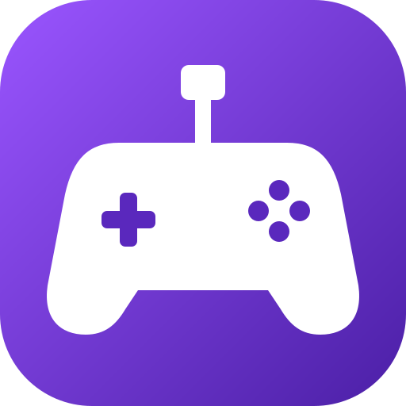
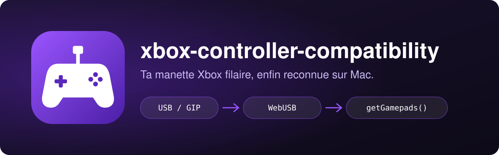
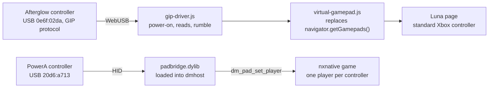

<div align="center">

[](README.md)



# xbox-controller-compatibility

**Use your wired PDP Afterglow Xbox controller on Amazon Luna, from your Mac.**<br>
macOS does not recognise it. A Brave extension talks to the controller over USB and shows it to Luna as a standard Xbox controller, rumble included. A bridge on the side gives PowerA controllers to native Switch ports.

[](LICENSE)
[](#requirements)
[](#installation)
[](extension/manifest.json)
[](#how-it-works)
[](macos/padbridge.c)
[](AGENTS.md)

</div>

<p align="center"></p>

## Why

macOS does not recognise the wired **PDP Afterglow for Xbox Series X** controller (USB `0e6f:02da`): it speaks the Xbox "GIP" protocol, and Apple's built-in driver only handles Microsoft controllers. As a result no game or website sees it, and the "Game Controllers" setting stays empty.

This repository works around it without installing a system driver:

- **On Amazon Luna**, a Brave extension opens the controller directly over WebUSB, sends it the Xbox power-on sequence, reads buttons, sticks and triggers, and shows them to Luna as a standard Xbox controller.
- **On native Switch game ports** (nxnative, such as Super Mario 3D World), a small bridge does the same for wired PowerA controllers, which the game ignores.

Tested on macOS 27 (Apple Silicon) with Brave: *Control* plays fine on Luna.

## How it works



The two parts are independent.

**The extension (`extension/`)**

1. It opens the controller directly over USB (WebUSB) and sends it the Xbox power-on sequence.
2. It reads buttons, sticks and triggers.
3. It shows them to Luna as a standard Xbox controller, with rumble.

It only acts on `luna.amazon.*` pages (`.com`, `.fr`, `.co.uk`, `.de`, `.es`, `.it`, `.ca`). The virtual controller takes the first free slot of `navigator.getGamepads()` and announces itself as an Xbox Series controller, so the game shows the right glyphs.

**The nxnative bridge (`macos/`)**

An nxnative port is an app that contains the `Contents/MacOS/nxnative` launcher and the `dmhost` engine, like `/Applications/Super Mario 3D World + Bowser's Fury.app`. These games only read controllers known to GameController.framework (Xbox, Joy-Con, DualSense...). Wired **PowerA "NSW wired controller"** pads (USB `20d6:a713`) do not show up there.

`padbridge.dylib` is loaded into `dmhost` at launch. It reads the PowerA pads over HID and hands them to the game through its `dm_pad_set_player` / `dm_pad_players` functions, with the Switch layout (A stays A), analogue sticks and one player per controller. It coexists with the controllers the game handles itself: two PowerA pads, Joy-Con and an Xbox controller make 4 players.

## Installation

```sh
curl -fsSL https://raw.githubusercontent.com/pyxl-dev/xbox-controller-compatibility/main/install.sh | sh
```

Brave has no command line to load an extension, so the installer cannot do that part for you. It downloads the repository into `~/.local/share/xbox-controller-compatibility`, a stable folder Brave can keep pointing at, checks Brave and `clang`, then prints the folder to load. Re-run it to update; `--uninstall` deletes the folder. It only touches your home folder and does not install the nxnative bridge.

Then, once:

1. Open Brave and go to `brave://extensions`.
2. Turn on **Developer mode** (top right).
3. Click **Load unpacked** and choose the `extension` folder the installer printed (`~/.local/share/xbox-controller-compatibility/extension`). If you cloned the repository yourself, use its `extension` folder.
4. Pin the "Afterglow pour Luna" extension in the toolbar (puzzle icon) if you want quick access to the test page.

After updating the repository, click the reload icon of the extension in `brave://extensions`.

### Let your AI agent do it

Paste this into Claude Code, Codex, Cursor or any agent with terminal access:

```text
Install xbox-controller-compatibility: https://github.com/pyxl-dev/xbox-controller-compatibility
Follow the AGENTS.md file in that repository.
```

[`AGENTS.md`](AGENTS.md) tells the agent how to download the repository, what it can do alone and what is left to you (loading the extension in Brave, plugging in the controller), and the safety rules.

### Requirements

| | Used for |
| --- | --- |
| macOS | everything (tested on macOS 27, Apple Silicon) |
| [Brave](https://brave.com/download) | the extension. Chrome and Edge also have WebUSB but were not tested; Safari and the Luna app do not |
| A wired PDP Afterglow Xbox controller | the extension (the picker also accepts other GIP controllers and the PDP `0e6f` and `24c6` USB vendor IDs, never tried) |
| A USB cable | plugging in the controller |
| `git` | the installer (comes with the Xcode tools: `xcode-select --install`) |
| `clang`, `make`, macOS 27 or later, Apple Silicon | only for the nxnative bridge: the `Makefile` builds for `arm64` with `-mmacosx-version-min=27.0` |
| A wired PowerA "NSW wired controller" and an nxnative port | only for the bridge |

## Usage

### Check the controller (optional but recommended)

1. Click the extension icon: a test page opens.
2. Click **Connecter la manette**, pick "Afterglow Wired Controller for Xbox Series X" in Brave's window, then **Connexion**.
3. The controller rumbles briefly. Press buttons: they light up on screen, the bars follow the sticks and triggers, and the last packet received is shown in hexadecimal.

### Play on Luna

1. Go to Luna in Brave (for example `https://luna.amazon.com`).
2. The first time, click the purple **Connecter la manette** button at the bottom right, pick the controller, then **Connexion**.
3. A "Manette Afterglow connectée" message appears and the controller rumbles: you are set.

After that, Brave remembers the permission: the controller reconnects by itself on every Luna visit, and also if you unplug and replug it.

### Troubleshooting

- **No picker window opens / "WebUSB est désactivé"**: check `brave://settings/content/usbDevices`: the option must let sites ask for access.
- **The controller is not in the list**: unplug and replug it, then reload the page. Also close other tabs or apps that might be using it, since only one program can open it at a time (the test page and Luna together, for example).
- **Luna does not react while the test page works**: reload the Luna page (`Cmd+R`). Open the console (`Cmd+Option+J`) and look for `[Afterglow → Luna]` lines.
- **Uninstall**: `brave://extensions`, then "Remove" on the extension. Nothing else is installed on the Mac, apart from the installer's folder (`./install.sh --uninstall`).

### Limits

- Works in Brave (Chrome and Edge should too, untested), **not in Safari** or the Luna app, which do not support WebUSB.
- The "Share" button and a headset plugged into the controller are not handled.

### PowerA controllers on nxnative ports (Super Mario 3D World...)

```sh
cd macos
./installer.sh
```

With no argument the script handles every nxnative port in `/Applications` and `~/Applications`. For a single game: `./installer.sh "/Applications/My game.app"`. Quit the games first: an open game is skipped. For each app the script builds the bridge, copies it into `Contents/Frameworks`, adds `DYLD_INSERT_LIBRARIES` to the `LSEnvironment` of its `Info.plist` and re-signs it ad hoc (as it originally was). The game then starts normally from the Dock or Finder. A backup of the modified files is kept per game in `~/Library/Application Support/padbridge/sauvegarde/<app identifier>`.

- **New port**: re-run `./installer.sh` after putting it in `/Applications`.
- **Remove the bridge**: `./installer.sh --retirer` (all games) or `./installer.sh --retirer "/Applications/My game.app"` puts the app back exactly as it was.
- **After an app was rebuilt** (new game version): re-run `./installer.sh`.
- **Without installing**: `./jouer.sh "/Applications/My game.app"` starts the game with the bridge for one session only (no argument if there is a single port).
- **Test the controllers outside a game**: `make padbridge-test && ./padbridge-test` prints every button (run it in `macos/`).
- **Diagnostics**: `[padbridge]` messages go to `~/Library/Logs/nxnative/<TITLE ID>.log` (the game writes its output there; `010028600EBDA000` for Mario). `PADBRIDGE_VERBOSE=1 ./jouer.sh` adds the addresses it found.

The bridge relies on the controller part of the `dmhost` engine, shared by nxnative ports. If a version no longer has the expected functions, the bridge disables itself and the game starts without it. A single-player game sends every controller to player 1.

**Swapped Joy-Con (A acts as B).** The game reads GameController pads by position, Xbox style. With combined Joy-Con (Capture + Home for 3 s), swap A/B and X/Y in **System Settings > Game Controllers**.

## Security

- The extension only injects into the Luna pages listed above. It makes no network request and stores nothing: it reads the controller over USB and shows it to the page.
- It replaces `navigator.getGamepads()` in the Luna page (`MAIN` world), which is what lets the game see it. Each site has to ask you for access to the controller, and Brave only grants it for the device you pick in its window.
- The online installer only downloads this repository into your home folder. The nxnative bridge is a separate step that you run yourself: it modifies the game app (`Info.plist`, ad hoc signature, `Contents/Frameworks`) after keeping a backup, and `--retirer` restores it.
- The repository contains no key or token. Read `macos/installer.sh` before running it, like any script that writes to `/Applications`.

## Development

```sh
git clone https://github.com/pyxl-dev/xbox-controller-compatibility && cd xbox-controller-compatibility
./install.sh                          # checks this clone and prints the extension folder
cd macos && make padbridge-test       # PowerA controller test tool
```

The extension has no build step: edit the files in `extension/`, then reload it in `brave://extensions`.

| File | Role |
| --- | --- |
| `extension/manifest.json` | manifest (Manifest V3): targeted Luna pages, background script |
| `extension/gip-driver.js` | Xbox GIP protocol driver on top of WebUSB |
| `extension/virtual-gamepad.js` | injected into Luna: exposes the controller through `navigator.getGamepads()` |
| `extension/tester.html` / `tester.js` | controller test page |
| `extension/background.js` | opens the test page when the icon is clicked |
| `macos/padbridge.c` | PowerA bridge to nxnative ports (injected library and test tool) |
| `macos/Makefile` | builds `padbridge.dylib` and `padbridge-test` |
| `macos/installer.sh` | installs or removes the bridge in nxnative ports |
| `macos/jouer.sh` | starts a port with the bridge without installing it |
| `install.sh` | one-line installer: downloads the repository and checks the requirements |
| `AGENTS.md` | instructions for any AI agent |

## License

[MIT](LICENSE). The GIP protocol is implemented after the open source Linux drivers [xpad](https://github.com/torvalds/linux/blob/master/drivers/input/joystick/xpad.c) and [xone](https://github.com/medusalix/xone).

Made with [Claude](https://claude.com/claude-code).
