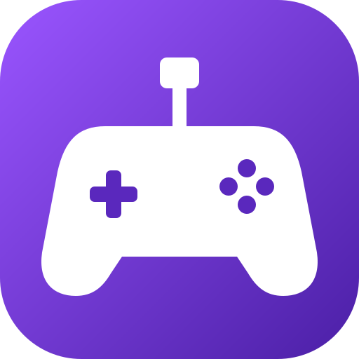
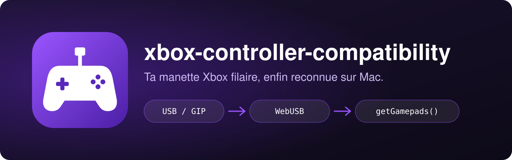
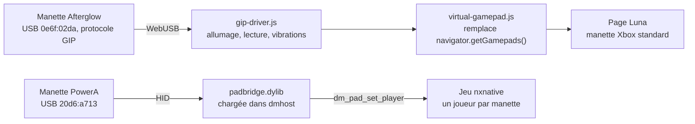

<div align="center">

[](README.en.md)



# xbox-controller-compatibility

**Utilise ta manette Xbox filaire PDP Afterglow sur Amazon Luna, depuis ton Mac.**<br>
macOS ne la reconnaît pas. Une extension Brave parle à la manette en USB et la présente à Luna comme une manette Xbox standard, vibrations comprises. Un pont en plus donne les manettes PowerA aux jeux Switch natifs.

[](LICENSE)
[](#prérequis)
[](#installation)
[](extension/manifest.json)
[](#comment-ça-marche)
[](macos/padbridge.c)
[](AGENTS.md)

</div>

<p align="center"></p>

## Pourquoi

macOS ne reconnaît pas la manette filaire **PDP Afterglow pour Xbox Series X** (USB `0e6f:02da`) : elle parle le protocole Xbox « GIP », et le pilote intégré d'Apple ne gère que les manettes Microsoft. Résultat : aucun jeu ni site ne la voit, et le réglage « Manettes de jeu » reste vide.

Ce dépôt contourne le problème sans installer de pilote système :

- **Sur Amazon Luna**, une extension Brave ouvre la manette en direct par WebUSB, lui envoie la séquence d'allumage Xbox, lit boutons, sticks et gâchettes, puis les montre à Luna comme une manette Xbox standard.
- **Sur les portages natifs de jeux Switch** (nxnative, comme Super Mario 3D World), un petit pont fait la même chose pour les manettes filaires PowerA, que le jeu ignore.

Testé sur macOS 27 (Apple Silicon) avec Brave : *Control* se joue sans problème sur Luna.

## Comment ça marche



Les deux parties sont indépendantes.

**L'extension (`extension/`)**

1. Elle ouvre la manette directement en USB (WebUSB) et lui envoie la séquence d'allumage Xbox.
2. Elle lit les boutons, les sticks et les gâchettes.
3. Elle les présente à Luna comme une manette Xbox standard, avec les vibrations.

Elle n'agit que sur les pages `luna.amazon.*` (`.com`, `.fr`, `.co.uk`, `.de`, `.es`, `.it`, `.ca`). La manette virtuelle prend le premier emplacement libre de `navigator.getGamepads()` et s'annonce comme une manette Xbox Series, pour que le jeu affiche les bons pictogrammes.

**Le pont nxnative (`macos/`)**

Un portage nxnative est une appli qui contient le lanceur `Contents/MacOS/nxnative` et le moteur `dmhost`, comme `/Applications/Super Mario 3D World + Bowser's Fury.app`. Ces jeux ne lisent que les manettes reconnues par GameController.framework (Xbox, Joy-Con, DualSense...). Les manettes filaires **PowerA « NSW wired controller »** (USB `20d6:a713`) n'y apparaissent pas.

`padbridge.dylib` est chargée dans `dmhost` au lancement. Elle lit les PowerA en HID et les donne au jeu par ses fonctions `dm_pad_set_player` / `dm_pad_players`, avec la disposition Switch (A reste A), les sticks analogiques et un joueur par manette. Elle cohabite avec les manettes gérées par le jeu : deux PowerA, des Joy-Con et une manette Xbox donnent 4 joueurs.

## Installation

```sh
curl -fsSL https://raw.githubusercontent.com/pyxl-dev/xbox-controller-compatibility/main/install.sh | sh
```

Brave n'a pas de ligne de commande pour charger une extension, donc l'installateur ne peut pas le faire à ta place. Il télécharge le dépôt dans `~/.local/share/xbox-controller-compatibility`, un dossier stable que Brave peut garder, vérifie Brave et `clang`, puis t'affiche le dossier à charger. Relance-le pour mettre à jour ; `--uninstall` supprime le dossier. Il ne touche qu'à ton dossier perso et n'installe pas le pont nxnative.

Ensuite, une seule fois :

1. Ouvre Brave et va sur `brave://extensions`.
2. Active **Mode développeur** (en haut à droite).
3. Clique sur **Charger l'extension non empaquetée** et choisis le dossier `extension` affiché par l'installateur (`~/.local/share/xbox-controller-compatibility/extension`). Si tu as cloné le dépôt toi-même, c'est son dossier `extension`.
4. Épingle l'extension « Afterglow pour Luna » dans la barre d'outils (icône puzzle) si tu veux accéder facilement à la page de test.

Après une mise à jour du dépôt, clique sur l'icône de rechargement de l'extension dans `brave://extensions`.

### Laisse ton agent IA s'en occuper

Colle ceci dans Claude Code, Codex, Cursor ou n'importe quel agent qui a accès à un terminal :

```text
Installe xbox-controller-compatibility : https://github.com/pyxl-dev/xbox-controller-compatibility
Suis le fichier AGENTS.md de ce dépôt.
```

[`AGENTS.md`](AGENTS.md) explique à l'agent comment télécharger le dépôt, ce qu'il peut faire seul et ce qui reste à faire par toi (charger l'extension dans Brave, brancher la manette), et les règles de sécurité. Il est en anglais, la langue que tous les agents lisent.

### Prérequis

| | Sert à |
| --- | --- |
| macOS | tout (testé sur macOS 27, Apple Silicon) |
| [Brave](https://brave.com/download) | l'extension. Chrome et Edge gèrent aussi WebUSB mais n'ont pas été testés ; Safari et l'appli Luna ne le gèrent pas |
| Une manette Xbox filaire PDP Afterglow | l'extension (la liste de choix accepte aussi les manettes GIP et les identifiants USB PDP `0e6f` et `24c6`, jamais essayés) |
| Un câble USB | brancher la manette |
| `git` | l'installateur (livré avec les outils Xcode : `xcode-select --install`) |
| `clang`, `make`, macOS 27 ou plus, Apple Silicon | seulement pour le pont nxnative : le `Makefile` compile en `arm64` avec `-mmacosx-version-min=27.0` |
| Une manette filaire PowerA « NSW wired controller » et un portage nxnative | seulement pour le pont |

## Utilisation

### Vérifier la manette (facultatif mais conseillé)

1. Clique sur l'icône de l'extension : une page de test s'ouvre.
2. Clique sur **Connecter la manette**, choisis « Afterglow Wired Controller for Xbox Series X » dans la fenêtre de Brave, puis **Connexion**.
3. La manette vibre brièvement. Appuie sur les boutons : ils s'allument à l'écran, les barres suivent les sticks et les gâchettes, et le dernier paquet reçu s'affiche en hexadécimal.

### Jouer sur Luna

1. Va sur Luna dans Brave (par exemple `https://luna.amazon.com`).
2. La première fois, clique sur le bouton violet **Connecter la manette** en bas à droite, choisis la manette, puis **Connexion**.
3. Un message « Manette Afterglow connectée » s'affiche et la manette vibre : c'est prêt.

Ensuite, Brave se souvient de l'autorisation : la manette se reconnecte toute seule à chaque visite sur Luna, et aussi si tu la débranches puis la rebranches.

### En cas de problème

- **Aucune fenêtre de choix ne s'ouvre / « WebUSB est désactivé »** : vérifie `brave://settings/content/usbDevices` : l'option doit permettre aux sites de demander l'accès.
- **La manette n'apparaît pas dans la liste** : débranche-la et rebranche-la, puis recharge la page. Ferme aussi les autres onglets ou applis qui l'utiliseraient, puisqu'un seul programme peut l'ouvrir à la fois (la page de test et Luna en même temps, par exemple).
- **Luna ne réagit pas alors que la page de test fonctionne** : recharge la page Luna (`Cmd+R`). Ouvre la console (`Cmd+Option+J`) et cherche les lignes `[Afterglow → Luna]`.
- **Désinstaller** : `brave://extensions`, puis « Supprimer » sur l'extension. Rien d'autre n'est installé sur le Mac, à part le dossier de l'installateur (`./install.sh --uninstall`).

### Limites

- Fonctionne dans Brave (Chrome et Edge devraient aussi, sans test), **pas dans Safari** ni dans l'appli Luna, qui ne gèrent pas WebUSB.
- Les boutons « Partager » et le casque branché sur la manette ne sont pas gérés.

### Manettes PowerA sur les portages nxnative (Super Mario 3D World...)

```sh
cd macos
./installer.sh
```

Sans argument, le script traite tous les portages nxnative de `/Applications` et `~/Applications`. Pour un seul jeu : `./installer.sh "/Applications/Mon jeu.app"`. Quitte les jeux avant : un jeu ouvert est sauté. Pour chaque appli, le script compile le pont, le copie dans `Contents/Frameworks`, ajoute `DYLD_INSERT_LIBRARIES` dans `LSEnvironment` de son `Info.plist` et la re-signe en ad hoc (comme à l'origine). Le jeu se lance ensuite normalement depuis le Dock ou le Finder. Une sauvegarde des fichiers modifiés est gardée par jeu dans `~/Library/Application Support/padbridge/sauvegarde/<identifiant de l'appli>`.

- **Nouveau portage** : relance `./installer.sh` après l'avoir mis dans `/Applications`.
- **Retirer le pont** : `./installer.sh --retirer` (tous les jeux) ou `./installer.sh --retirer "/Applications/Mon jeu.app"` remet l'appli exactement comme avant.
- **Après une reconstruction d'une appli** (nouvelle version du jeu) : relance `./installer.sh`.
- **Sans installer** : `./jouer.sh "/Applications/Mon jeu.app"` lance le jeu avec le pont pour une seule partie (sans argument s'il n'y a qu'un portage).
- **Tester les manettes hors jeu** : `make padbridge-test && ./padbridge-test` affiche chaque bouton (à lancer dans `macos/`).
- **Diagnostic** : les messages `[padbridge]` sont dans `~/Library/Logs/nxnative/<TITLE ID>.log` (le jeu y écrit sa sortie ; `010028600EBDA000` pour Mario). `PADBRIDGE_VERBOSE=1 ./jouer.sh` y ajoute les adresses trouvées.

Le pont dépend de la partie manettes du moteur `dmhost`, commune aux portages nxnative. Si une version ne contient plus les fonctions attendues, le pont se désactive tout seul et le jeu se lance sans lui. Un jeu solo envoie toutes les manettes au joueur 1.

**Joy-Con inversés (A agit comme B).** Le jeu lit les manettes GameController par position, à la manière Xbox. Avec des Joy-Con combinés (Capture + Home 3 s), inverse A/B et X/Y dans **Réglages Système > Manettes de jeu**.

## Sécurité

- L'extension ne s'injecte que sur les pages Luna listées plus haut. Elle ne fait aucune requête réseau et ne stocke rien : elle lit la manette en USB et la montre à la page.
- Elle remplace `navigator.getGamepads()` dans la page Luna (monde `MAIN`), c'est ce qui permet au jeu de la voir. Chaque site doit te demander l'accès à la manette, et Brave ne l'accorde que pour l'appareil que tu choisis dans sa fenêtre.
- L'installateur en ligne ne fait que télécharger ce dépôt dans ton dossier perso. Le pont nxnative est une étape à part, que tu lances toi-même : il modifie l'appli du jeu (`Info.plist`, signature ad hoc, `Contents/Frameworks`) après en avoir gardé une sauvegarde, et `--retirer` la restaure.
- Le dépôt ne contient aucune clé ni aucun jeton. Lis `macos/installer.sh` avant de le lancer, comme tout script qui écrit dans `/Applications`.

## Développement

```sh
git clone https://github.com/pyxl-dev/xbox-controller-compatibility && cd xbox-controller-compatibility
./install.sh                          # vérifie ce clone et affiche le dossier de l'extension
cd macos && make padbridge-test       # outil de test des manettes PowerA
```

L'extension n'a aucune étape de compilation : modifie les fichiers de `extension/`, puis recharge-la dans `brave://extensions`.

| Fichier | Rôle |
| --- | --- |
| `extension/manifest.json` | manifeste (Manifest V3) : pages Luna ciblées, script de fond |
| `extension/gip-driver.js` | pilote du protocole Xbox GIP au-dessus de WebUSB |
| `extension/virtual-gamepad.js` | injecté dans Luna : expose la manette via `navigator.getGamepads()` |
| `extension/tester.html` / `tester.js` | page de test de la manette |
| `extension/background.js` | ouvre la page de test au clic sur l'icône |
| `macos/padbridge.c` | pont PowerA vers les portages nxnative (bibliothèque injectée et outil de test) |
| `macos/Makefile` | compile `padbridge.dylib` et `padbridge-test` |
| `macos/installer.sh` | installe ou retire le pont dans les portages nxnative |
| `macos/jouer.sh` | lance un portage avec le pont sans l'installer |
| `install.sh` | installateur en une ligne : télécharge le dépôt et vérifie les prérequis |
| `AGENTS.md` | instructions pour n'importe quel agent IA |

## Licence

[MIT](LICENSE). Le protocole GIP est implémenté d'après les pilotes Linux open source [xpad](https://github.com/torvalds/linux/blob/master/drivers/input/joystick/xpad.c) et [xone](https://github.com/medusalix/xone).

Créé avec [Claude](https://claude.com/claude-code).
